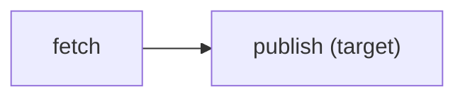

# `kazeflow plan`

Resolve a flow and render its selected dependency plan without invoking asset bodies
after the entry has loaded.

## Synopsis

```console
kazeflow plan ENTRY \
  [--target NAME ...] \
  [--partition-key KEY ... | --partition-range START END | --empty-partitions] \
  [--max-concurrency N] [--verbose] \
  [--format text|json|mermaid|dot]
```

## Selection options

| Option | Meaning |
| --- | --- |
| `--target NAME` | Select a target; repeat for several targets. |
| `--partition-key KEY`, `--partition KEY` | Select one key; repeat as needed. The selected definition normalizes or rejects each key. |
| `--partition-range START END` | Select one inclusive bounded range when the selected definition supports ranges. |
| `--empty-partitions` | Deliberately select no partition attempts. |
| `--max-concurrency N` | Review a positive normalized execution concurrency. |
| `--verbose` | Add task/configuration detail to text output only. |

Flows may declare named invocation limits with `ResourcePolicy` and associate
assets via `@asset(resource="network")`. A text plan lists only resources used by
the selected dependency closure and annotates each associated task. `max_concurrency`
bounds simultaneous invocations. An optional `RateLimit(requests, per_seconds)`
bounds asset body invocation starts in each rolling time window. Both limits are
shared across matching assets and keys within one run. The rate limit counts an asset
body start after a materialization miss; it does not count cache hits or individual
API requests, and separate runs have independent limits. Resource names are
application-chosen metadata and may reveal information, so do not use secrets as
names.

Flows may also declare `PartitionGroup` values for disjoint linear chains of
partitioned assets. A group bounds how many selected keys progress through all
members before another key is admitted. This key limit is independent of global
invocation concurrency and resource limits. The text plan shows selected groups;
there are no CLI group flags. Define groups in the trusted Python flow and review
them in the plan before running. See [Bound progress through a partition
chain](../partitions.md#bound-progress-through-a-partition-chain).

The same selected resource can configure `max_attempts` and `classify_failure` for
explicit retries. The plan shows the invocation budget and a boolean indicating
whether a classifier is configured; it never serializes callback code. The budget
includes the first invocation. No classifier means no retry, even if the budget is
greater than one.

Partition selectors are mutually exclusive. A partitioned closure requires exactly
one selection form; omitting one is a preflight configuration error. Passing any
selector to an unpartitioned closure is a usage error. Neither case invokes an asset
body.

## Graph formats

```console
kazeflow plan daily.py
kazeflow plan daily.py --format mermaid
kazeflow plan daily.py --format dot > flow.dot
```

Mermaid output is directly pasteable into compatible Markdown:



kazeflow emits graph source but does not install or invoke Mermaid or Graphviz.

## JSON boundary

The JSON plan projection is deterministic and intentionally lossy. It reports the
selection kind, stable domain, and safe counts rather than serializing arbitrary raw
partition keys. Text, JSON, Mermaid, and DOT plans preserve this no-raw-key boundary.
Use JSON instead of parsing text whitespace. Plan documents in this unreleased
change use schema version 5 and include selected groups without raw keys; check the installed package and see the
[JSON automation contract](json.md) for migration guidance and schemas.
